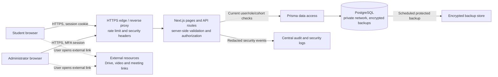

# Threat Model and Security Design Architecture

## 1. System and security objectives

The system is the ICT tuition LMS: student and administrator browsers communicate with a Next.js application, which reads and writes learning records in PostgreSQL through Prisma. The main objectives are to protect student information, keep grades and submissions accurate, limit content to the intended cohort, prevent account takeover and script injection, and recover from operational failure.

## 2. Data flow and trust boundaries

**Trust boundaries:** (1) public internet to HTTPS edge; (2) browser to application; (3) application to private database; (4) application to log/backup services; (5) LMS to third-party links. Student-supplied content and externally hosted resources must be treated as untrusted even after authentication.

## 3. Key data flows

1. **Sign-in:** browser sends email/password over HTTPS; server looks up the account, verifies a password hash, and returns a signed HttpOnly session cookie.
2. **Student learning:** browser requests courses, classroom items, quizzes, progress, or results. The server loads the current account and applies grade/medium and record-ownership checks before returning data.
3. **Assignment:** a student submits text and an optional file URL. The server checks the student role and cohort; a teacher/admin reads submissions and returns marks/feedback.
4. **Content administration:** an administrator creates or changes course, lesson, quiz, paper, classroom, and user records. Content can later be rendered in student browsers, so rendering must be safe.
5. **Operations:** the application connects to PostgreSQL using a configured secret. Logs, backups, and restore operations must follow the policy.

## 4. STRIDE threat analysis

| Threat category | Threat scenario | Existing protection observed | Proposed treatment |
| --- | --- | --- | --- |
| **Spoofing** | An attacker guesses a student's or administrator's password, or reuses a stolen session. | bcrypt password hashing; generic login failure; HttpOnly cookie; signed JWT with seven-day expiry. | Rate limit and alert on failed logins; administrator MFA; shorter/revocable privileged sessions; password strength and recovery rules. |
| **Tampering** | A student changes request fields to award marks, modify another user's profile, or submit against a different cohort. | Mutation handlers generally call `requireUser`; student submissions are matched to current user/cohort; grading endpoints require administrator. | Maintain server-side authorization on every route; validate all fields with schemas; add audit trail for high-impact writes; test ownership boundaries. |
| **Repudiation** | An administrator denies changing a role, deleting a user, or returning a grade. | General error logging exists, but no durable audit event design was found. | Store time-stamped, attributable audit events with actor, action, target, and result; protect access and retention. |
| **Information disclosure** | A student retrieves another cohort's papers or another student's assessment result. | Results filter by authenticated user; courses/quizzes/classroom are cohort-scoped. | Scope `/api/papers` using the current user; maintain explicit authorization matrix and negative access checks. |
| **Denial of service** | Repeated login attempts or unusually large requests consume compute or database resources. | Bounded limits exist for some classroom data. No login throttling or common request limit policy was found. | Edge and route rate limits; request body limits; pagination; bounded query parameters; alert on abnormal traffic. |
| **Elevation of privilege** | A learner reaches administrator operations or an injected lesson snippet runs with learner authority. | Proxy blocks non-admin tokens from admin routes; handlers also check the current database role. | Keep dual page/API checks; enforce MFA and least privilege; remove inline execution and raw HTML; sandbox educational code with an opaque origin and restricted capabilities. |

## 5. Abuse cases and control requirements

### A. Malicious lesson content executes in a learner session

An attacker who compromises an administrator account publishes a lesson containing script-capable HTML or a JavaScript snippet. A student opens the lesson and uses the runner; injected code may make same-origin requests as that student. The content path is especially important because the renderer enables raw HTML and evaluates JavaScript in the browser.

**Required design:** render plain Markdown or sanitize HTML using a small allowlist; remove `new Function` execution from the application origin; use a sandboxed iframe with no `allow-same-origin`, minimal permissions, and a restrictive CSP for demonstrations. Add a site-wide CSP as defense in depth. Review content access and changes.

### B. A student enumerates other cohort materials

A student changes `grade` and `medium` query parameters in the papers API. The current route applies request values directly instead of constraining them to the authenticated student's profile.

**Required design:** query the current user from the database; ignore student-supplied cohort values; only allow an administrator to query across cohorts; include authorization-negative cases in release review.

### C. Password guessing against an administrator

An attacker repeatedly submits guesses to the login route. Password hashing slows a single guess but does not limit request volume.

**Required design:** apply account and network-aware rate limits, escalating delays, alerts, administrator MFA, and a recovery procedure. Avoid permanent account lockout that an attacker could weaponize to deny service.

## 6. Target security architecture

1. **Browser/edge:** HTTPS only; HSTS; CSP; `X-Content-Type-Options`; a conservative `Referrer-Policy`; and a restrictive `Permissions-Policy`. Apply request size and rate limits at the edge.
2. **Authentication:** individually attributable accounts, bcrypt or an appropriately configured password-hash function, administrator MFA, short privileged sessions, secure cookies, and a revocation mechanism.
3. **Application authorization:** each API route calls a shared server-side authorization layer. It loads the current user from the database and checks role, ownership, and cohort before querying or mutating records. Inputs are validated through shared schemas.
4. **Content safety:** safe Markdown with HTML sanitization; no same-origin arbitrary JavaScript execution; isolated sandbox for examples; externally supplied URLs allow only approved schemes and are shown as untrusted links.
5. **Database:** private network access from the application only; separate least-privilege production credentials; encrypted connection and storage according to hosting support; migrations reviewed and recoverable.
6. **Operations:** central redacted audit logs, monitoring and alerts, encrypted backups, tested restoration, defined retention, and incident-response ownership.

## 7. Verification criteria

- Unauthenticated requests to protected APIs return 401; students invoking administrator APIs receive 403.
- Students cannot read or change another student's results, submission, profile, or marks.
- Student course, quiz, classroom, and paper results are constrained to the current database cohort.
- Quiz response payloads never include correct answer keys.
- Published lesson content cannot execute script in the LMS origin; examples run only in the approved isolated sandbox.
- Repeated login attempts are throttled and produce a monitoring event without exposing account existence.
- Privileged changes produce an attributable audit event; logs do not contain credentials or session tokens.
- A database backup can be restored within the documented recovery objectives.
